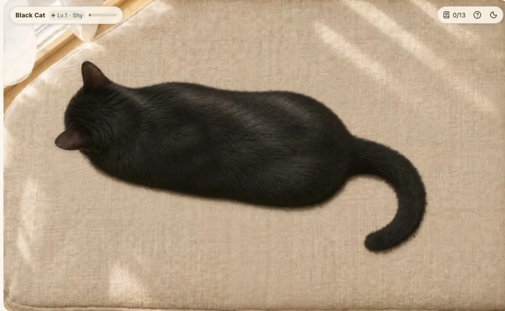

# Free Pet the Cat Online

Pet a virtual cat for free in your browser. Choose from 13 cats, including a Siamese, a Ragdoll, a Siberian, and a Norwegian Forest Cat. You can also pick a cat by its coat, such as an orange tabby or a calico.

[Play Pet the Cat](https://petthecatonline.github.io/)

## How to play

- Stroke your cat’s head or back with your mouse or finger. On a keyboard, focus the play area and press `Space` to pet the back, `T` for the tail, or `P` for a butt pat.
- Turn on sound for meows and purrs. Try a feather wand or a laser dot, earn fish treats by completing cat wishes, and dress your cat in a crown or sunglasses.
- Adjust your cat’s size and width, or switch to moonlight. Open **Stats & Collection** to see your time with each cat in the **Petting Journal** and watch your bond grow from **Shy** to **Best friends**.
